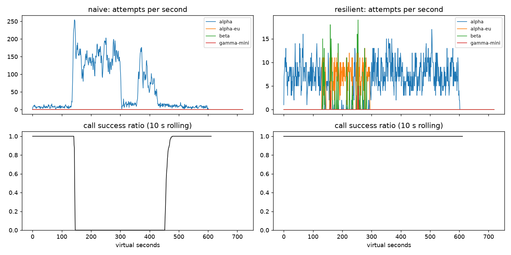

# Lab 25B — Report

**Họ tên / nhóm:** Vũ Đình Thu / 2A202602652  
**Commit:** TODO — thay bằng commit hash sau khi commit  
**Điểm tự động (`python scripts/grade.py`):** 84 / 88 (4 điểm hidden SLO do giảng viên chấm)

## 1. Kết quả Game Day

| Băng | Client | availability | p95 (s) | amplification | retry ratio | cost/turn | recovery (s) | PASS |
|---|---|---:|---:|---:|---:|---:|---:|:---:|
| G1 | naive | 0.7194 | 7.157 | 7.738 | 6.738 | 2.163 | 4 | no |
| G1 | resilient | 1.0000 | 4.780 | 1.063 | 0.001 | 2.104 | 0 | yes |
| G2 | naive | 0.4560 | 15.034 | 9.904 | 8.904 | 4.627 | 155 | no |
| G2 | resilient | 1.0000 | 10.362 | 1.036 | 0.005 | 2.108 | 0 | yes |
| G3 | naive | 1.0000 | 4.768 | 1.164 | 0.164 | 2.328 | 0 | no |
| G3 | resilient | 1.0000 | 4.668 | 1.059 | 0.030 | 2.143 | 0 | yes |
| G4 | naive | 1.0000 | 13.764 | 1.004 | 0.004 | 2.008 | 0 | no |
| G4 | resilient | 1.0000 | 5.626 | 1.014 | 0.002 | 2.072 | 0 | yes |
| G5 | naive | 0.3699 | 5.359 | 17.030 | 16.030 | 2.124 | — | no |
| G5 | resilient | 0.8179 | 5.477 | 1.003 | 0.002 | 2.504 | — | yes |
| G6 | naive | 0.5170 | 4.836 | 12.344 | 11.344 | 2.009 | 0 | no |
| G6 | resilient | 1.0000 | 6.025 | 1.056 | 0.019 | 2.188 | 0 | yes |

## 2. Cấu hình client và lý do

| Tham số | Giá trị | Lý do |
|---|---:|---|
| attempt timeout | 8 s | Đủ cho call bình thường nhưng chừa thời gian failover trong deadline 30 s; G6 vẫn đạt availability 1.0. |
| max attempts/provider | 2 | Một retry cùng provider trước spillover; G2 amplification chỉ 1.036. |
| backoff base/cap | 0.25 / 4 s | Full jitter tránh retry đồng loạt. |
| retry budget ratio | 0.10 | Giữ G3 retry ratio ở 0.030 và chặn retry storm. |
| breaker window/min calls | 20 / 10 | Có đủ mẫu trước khi mở breaker, nhưng phản ứng sớm với sự cố kéo dài. |
| failure threshold | 0.50 | G2 và G6 nhanh chóng tách traffic khỏi provider lỗi. |
| slow call threshold | 5 s | Bắt được G4 trước khi timeout; p95 giảm từ 13.764 xuống 5.626 s. |
| open duration / probes | 10 s / 2 | Thử phục hồi có kiểm soát; G2 quay về alpha ngay sau restore. |

| Loại lỗi | Breaker | Hành động |
|---|---|---|
| client error | release | GiveUp; không retry/failover |
| quota exhausted | release | cooldown 300 s rồi failover |
| rate limited | release | tôn trọng retry-after, cooldown dùng chung rồi failover |
| overload/server error/timeout | failure | retry một lần với jitter nếu budget/deadline cho phép, sau đó failover |

## 3. Thí nghiệm

1. **Retry budget.** Với cấu hình final, G2 có amplification 1.036 và G3 có retry ratio 0.030, thấp hơn giới hạn 1.6 và 0.10. So với naive, G2 amplification là 9.904 và G3 retry ratio là 0.164. Breaker ngắt một provider không khỏe; retry budget là lớp chặn độc lập khi breaker chưa đủ mẫu hoặc cấu hình bị sai.
2. **Timeout và failover.** Timeout 8 s giúp G6 đạt availability 1.0 và p95 6.025 s. Timeout 30 s sẽ giữ slot với alpha-eu đang treo, làm mất phần deadline cần thiết để đến beta; p95 của các lượt còn sống không phản ánh các lượt hết hạn, nên availability là chỉ số quyết định.
3. **Tool capability.** `ladder("tool")` loại gamma-mini. Kết quả G6 có `incompatible_routes = 0`: người dùng không nhận câu trả lời chat thay cho thao tác hoàn tiền chỉ vì model rẻ nhất còn hoạt động.

## 4. Workflow hoàn tiền

| Executor | completion | crashes | duplicate refunds | duplicate emails | lost refunds | overpaid | wasted LLM/crash |
|---|---:|---:|---:|---:|---:|---:|---:|
| naive | 1.0000 | 81 | 128 | 81 | 0 | 1,496,700 | 1.123 |
| yours | 1.0000 | 66 | 0 | 0 | 0 | 0 | 0.303 |

Idempotency key đảm bảo retry của payment/email không tạo effect trùng, kể cả khi response bị mất. Checkpoint tránh chạy lại các bước đã hoàn tất sau crash và giảm LLM bị lãng phí. Chỉ checkpoint là chưa đủ vì crash sau payment nhưng trước checkpoint vẫn có thể gọi payment lại; chỉ key là chưa đủ vì các LLM/read step vẫn chạy lại. Nếu checkpoint được ghi trước payment, worker có thể crash trước effect và bỏ qua hoàn tiền vĩnh viễn.

## 5. Alerting và error budget

Burn-rate alerter tạo 3 page, 1 ticket và 0 false page; naive tạo 7 page, 0 ticket và 3 false page. Burn-rate phát hiện checkout bug sau 27 phút, provider outage sau 4 phút, degraded evening sau 291 phút, và tạo ticket slow leak sau 1337 phút; deploy blip, night spike, small bump không page.

30 ngày có 25,901,755 request, budget cho phép 129,508.8 lỗi; có 55,618 lỗi. Availability là 0.997853, đã dùng 42.95% budget và còn 57.05%, nên chưa freeze release. `small_bump` chỉ tiêu một phần nhỏ budget và không đủ cả long/short window; page sẽ tạo nhiễu cho on-call.

## 6. Postmortem G2 — naive client (blameless)

**Tóm tắt.** Alpha mất 75% GPU từ t=120 đến t=300. Client naive có ba tầng retry cố định nên biến sự cố capacity thành retry storm: availability chỉ 45.60%, amplification 9.904 và recovery mất 155 s. Đây là lỗi của thiết kế retry và thiếu cơ chế tải giảm, không phải lỗi của cá nhân vận hành.

| t | Sự kiện | Bằng chứng từ CSV |
|---:|---|---|
| 119 | bình thường | 7/7 call thành công; 9 attempt alpha |
| 120 | alpha mất 75% capacity | 7/7 call còn hoàn tất, 5 attempt alpha |
| 121 | hàng đợi bắt đầu nghẽn | chỉ 2/2 call thành công; 7 attempt alpha |
| 122 | retry storm hình thành | 0/0 call thành công; vẫn 3 attempt alpha |
| 299 | ngay trước restore | 0/1 call thành công; 136 attempt alpha |
| 300 | provider restore | 0/5 call thành công; vẫn 115 attempt alpha |
| 420 | chưa hồi phục | 0/2 call thành công; 53 attempt alpha |
| 456 | phục hồi dần | 8/8 call thành công; 15 attempt alpha |

**Trigger và root cause.** Trigger là mất GPU. Root cause là retry ở app, gateway và SDK không jitter/budget/breaker, khuếch đại traffic vào hàng đợi. Khi client timeout, request server vẫn chạy; sau t=300, hàng đợi vẫn đầy request mà client đã bỏ và retry mới tiếp tục giữ tải vượt capacity — vòng lặp metastable này giải thích recovery 155 s.

| # | Hành động | Loại | Owner | Kiểm chứng |
|---:|---|---|---|---|
| 1 | Một retry layer với full jitter + budget | prevent | Agent platform | G2 amplification <= 1.2 trong CI |
| 2 | Per-provider sliding-window breaker | mitigate | Reliability | G2 recovery <= 30 s |
| 3 | Alert amplification và queue delay | detect | SRE | page khi amplification > 1.6 trong 5 phút |

## 7. Điểm yếu còn lại

Khi tất cả provider cùng chậm nhưng chưa lỗi, breaker có thể giữ một số traffic trên route chậm cho tới khi đủ mẫu. Bước tiếp theo là bổ sung adaptive concurrency và latency-based load shedding; chi phí beta cũng nên là tín hiệu trong policy routing khi sự cố kéo dài.

## 8. Cache

| Client | availability | FAQ availability | hit ratio | stale served | wrong | outdated | cost/turn | PASS |
|---|---:|---:|---:|---:|---:|---:|---:|:---:|
| resilient | 0.8373 | 0.8424 | 0.000 | 0 | 0 | 0 | 1.386 | no |
| cached | 0.9124 | 0.9645 | 0.652 | 157 | 0 | 3 | 0.915 | yes |

| Tham số | Giá trị | Lý do |
|---|---:|---|
| similarity threshold | 0.95 | Starter 0.80 trả sai 181 câu (`other_question`); 0.95 trả sai 0 câu. |
| TTL | 60 s | Giới hạn dữ liệu shipping thay đổi không có webhook; chỉ còn 3 outdated answer. |
| max stale | 300 s | Bao phủ outage 120 s; FAQ availability tăng từ 84.24% (không cache) lên 96.45%. |

Không cache câu hỏi cá nhân vì embedding gần nhau không chứng minh cùng quyền truy cập; cache theo user vẫn tạo rủi ro thay đổi dữ liệu, truy cập sai scope và rò rỉ. Khi stale được phục vụ, dashboard availability có thể xanh; on-call cần alert đồng thời trên provider error/give-up rate, stale-served count và cache hit ratio bất thường.
